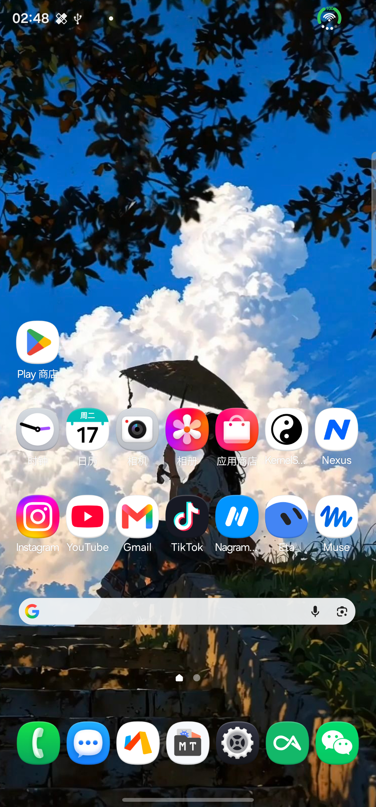
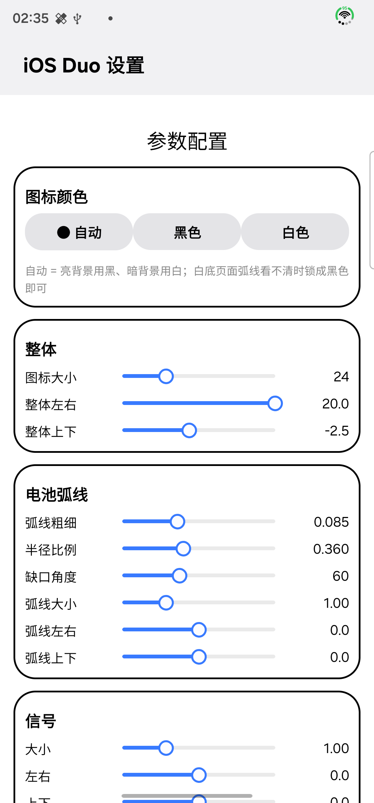

# Android仿iphone Duo状态栏

> **作者：追风少年** · 版权所有 © 2025 追风少年 · 保留所有权利

把三星 One UI 状态栏改造成 iPhone 灵动岛风格「三合一」图标的 LSPosed 模块：**电池弧 + WiFi + 信号点** 合并成一颗圆形组件，原生电池、信号、WiFi、5G 图标全部隐藏，下拉通知栏也不移位、不闪现。

---

## ⚠️ 版权声明（必读）

**本项目是闭源项目（Proprietary / Closed Source），不是开源软件。**

- 仓库内公开的安装包与源码**仅供个人学习、研究与自用刷机**，不构成任何开源许可授权。
- **未授予**你复制、修改、再分发、二次打包、商用、上架应用商店、或用于任何盈利目的的权利。
- 未经作者书面许可，禁止以任何形式转载、搬运、套壳、改名发布，禁止用于任何付费渠道。
- 转载必须保留作者署名「追风少年」与本仓库地址。

详见 [COPYRIGHT](COPYRIGHT)。

任何使用行为均视为你已阅读并同意上述条款。作者不对使用本模块造成的任何设备损坏、数据丢失、保修失效负责。

---

## 效果

| 桌面 | 锁屏 | 设置页（白底自适应） |
|---|---|---|
|  |  |  |

## 功能特性

- **三合一图标**：电池弧线 + 电量数字 + WiFi 扇面 + 4 点信号强度 + 5G/4G 文本，全部画在一个圆形组件里。
- **原生图标全隐藏**：电池、信号、WiFi、蜂窝数据、5G 图标彻底隐藏，切应用、插拔充电器都不再闪现。
- **下拉不移位**：位置只统计状态栏带内 + 右半屏的原生图标包围盒，纵向钳制在状态栏高度内；桌面 / 一级下拉 / 完全展开 QS 三态位置恒定。
- **颜色自适应**：白底页面黑色图标、深色背景白色图标。按宿主优先级取状态栏时钟前景色判定，锁屏大时钟不会污染桌面颜色。设置页可手动锁定「自动 / 黑色 / 白色」。
- **WiFi 与 5G 双向互斥**：WiFi 连通只显示 WiFi，WiFi 断开只显示 5G，尺寸与位置完全对齐。
- **信号点方向与电量弧一致**：都从左下起始填充。
- **实时设置**：滑块调整立即生效（40ms 合并广播），双击滑块可输入精确数值，恢复默认一键还原。
- **桌面 / 锁屏 / 下拉共用一套参数**：改一处，三处同步，无重影。

## 兼容性

| 项目 | 要求 |
|---|---|
| 系统 | One UI 8.5 / Android 16（三星 SM-S9180 / S23 Ultra 实测） |
| 框架 | LSPosed（Zygisk 或 KernelSU 均可） |
| 作用域 | `com.android.systemui` |
| minSdk | 24 |

> 其他 One UI 版本可尝试，但原生图标类名与布局可能不同，隐藏逻辑会失效。

## 安装

1. 下载 [`release/IOSDuo-ThreeInOne-v2.5-rb.apk`](release/)
2. 安装后到 **LSPosed 管理器** 启用模块，作用域勾选 **SystemUI（com.android.systemui）**
3. 重启 SystemUI 或重启手机
4. 打开「三合一」App 调整参数，改动实时生效

签名校验失败请先卸载旧版再装（本项目签名与任何第三方改版不通用）。

## 使用说明

- **图标颜色**：自动 = 亮背景黑、暗背景白；某个页面判定不准时直接锁「黑色」或「白色」。
- **双击滑块**：弹出输入框，可写入超出滑块范围之外也不行的精确值。
- **恢复默认**：清空所有 SharedPreferences 并刷新。

参数分组：整体（图标大小、整体左右/上下）、电池弧线（粗细、半径、缺口角度、大小、左右、上下）、信号、WiFi、5G/4G、电池数字。

## 自行构建

需要 JDK + Android SDK（build-tools 36 / platform 36）。签名密钥**不在仓库内**，请自备 keystore。

```powershell
# Windows
$env:JAVA_HOME     = "D:\Tools\jdk25"
$env:IOSDUO_KS     = "C:\path\to\your.jks"
$env:IOSDUO_KS_PASS = "your-keystore-password"
powershell -NoProfile -ExecutionPolicy Bypass -File .\sources\build.ps1
```

```bash
# Linux / macOS
export IOSDUO_KS=/path/to/your.jks
export IOSDUO_KS_PASS=your-keystore-password
bash sources/build.sh
```

构建脚本会从 `sources/../sdk/` 下的 `bt36.zip` / `platform36.zip` 自动解压 SDK 组件（需自行从 [dl.google.com/android/repository](https://dl.google.com/android/repository/) 下载放置）。

## 目录结构

```
sources/           模块源码（Java，无第三方依赖）
  src/com/dsh/iosduo/
    Module.java           LSPosed 入口与 hook 注册
    Injector.java         核心：图标扫描、隐藏、位置计算、取色、广播
    DuoRingDrawable.java  绘制：电池弧、信号点、WiFi、5G、电量数字
    StatusData.java       状态采集：电量、WiFi、信号、制式（600ms 刷新）
    Cfg.java              参数与实时下发
    SettingsActivity.java 设置界面
  stubs/           Xposed API 编译桩（仅为编译，不打包）
  assets/xposed_init
  AndroidManifest.xml
  build.ps1 / build.sh / deploy.ps1
release/           已签名安装包
screenshots/       实机截图
docs/CHANGELOG.md  版本变更记录
```

## 版本

当前 **v2.5-rb**（versionCode 25）。完整变更见 [docs/CHANGELOG.md](docs/CHANGELOG.md)。

## 致谢

- 图标形态参考 iOS 灵动岛 / 状态栏视觉语言
- Xposed / LSPosed 社区

---

**作者：追风少年** · 有问题欢迎提 Issue（不保证回复，不接受功能定制）。
